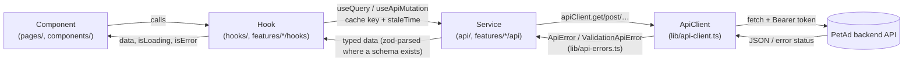
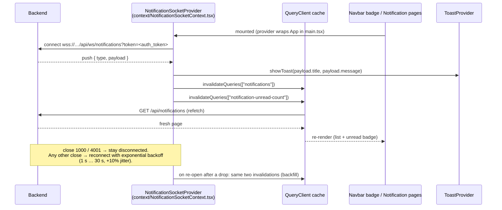
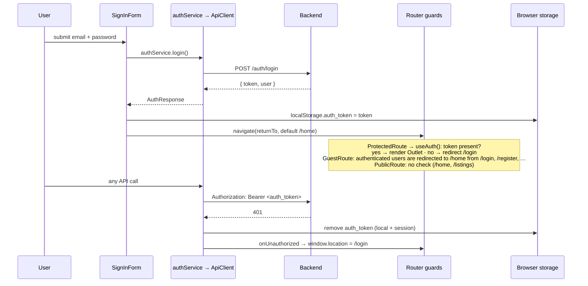
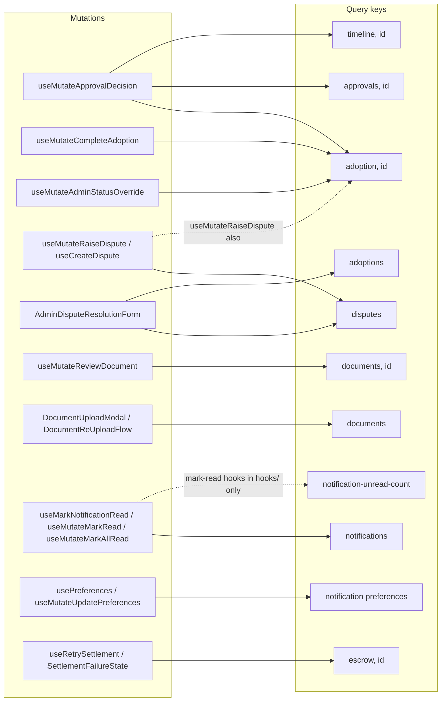
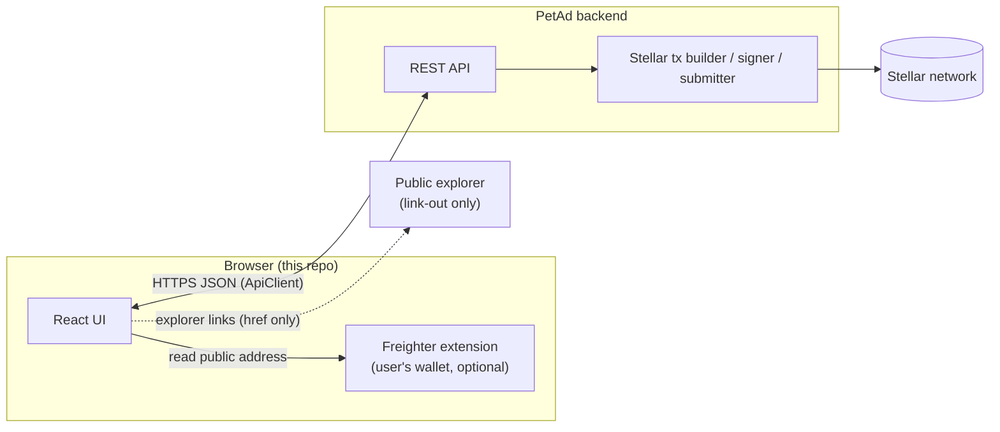

# Architecture and Data Flow

How data moves through the PetAd frontend, and where the frontend stops. Every
diagram is Mermaid (renders on GitHub) and was written against the code at the
paths cited. If you change one of those files, update the matching diagram.

- [1. Request flow](#1-request-flow)
- [2. Realtime flow](#2-realtime-flow)
- [3. Auth and session flow](#3-auth-and-session-flow)
- [4. Cache-invalidation map](#4-cache-invalidation-map)
- [5. Frontend / blockchain boundary](#5-frontend--blockchain-boundary)
- [6. Known deviations](#6-known-deviations)

---

## 1. Request flow

Reads and writes follow the same layering: **component → hook → service →
`ApiClient` → backend**. Components never call `fetch` or `ApiClient` directly;
hooks own caching (TanStack Query); services own URLs and response shapes.

What each layer does (in the code):

| Layer | Location | Responsibility |
|-------|----------|----------------|
| Component | `src/pages`, `src/components` | Render `data` / `isLoading` / `isError`; never talk to the network. |
| Hook | `src/hooks`, `src/lib/hooks`, `src/features/*/hooks` | Query keys, `staleTime` (set per hook), optimistic updates, invalidation. `useApiQuery` and `useApiMutation` are the shared wrappers. |
| Service | `src/api`, `src/features/*/api` | One object per domain (`adoptionService`, `custodyService`, …). Knows endpoints; validates responses with zod where a schema exists (`features/*/schemas`). |
| `ApiClient` | `src/lib/api-client.ts` | Adds `Authorization: Bearer <auth_token>`, normalises failures to `ApiError` (`422` → `ValidationApiError` with `fields`), maps `fetch` failures to `NETWORK_ERROR`, handles `401` (see §3). Base URL is `VITE_API_URL`, or `/api` when `VITE_MSW=true`. |
| Global error hook | `src/lib/query-client.ts` | Every failed query/mutation is logged through `logger` (PII-scrubbed, see `src/lib/logger.ts`). Defaults: `staleTime` 30 s, `retry` 2 with exponential backoff for queries, `retry` 0 for mutations. |

In tests and in `VITE_MSW=true` dev mode the backend is replaced by MSW handlers
in `src/mocks/handlers/*` — the layers above are unchanged.

---

## 2. Realtime flow

Notifications arrive over a WebSocket (`/api/ws/notifications`, protocol
decisions in [`notifications.md`](notifications.md)). The socket does **not**
carry state into the UI directly: a push only **invalidates** the notification
queries, and TanStack Query refetches over REST. REST is therefore always the
source of truth, and a dropped socket loses nothing — a reconnect triggers the
same refetch as a backfill.

Cache **merge** (not refetch) happens for the user's own actions only. Marking
read applies an optimistic `isRead: true` write across every `["notifications"]`
query via `setQueriesData` (`hooks/useMutateMarkRead.ts`,
`features/notifications/hooks/useMarkNotificationRead.ts`), rolls back on error,
then invalidates.

`src/lib/realtime/notificationSocket.ts` is a more capable, framework-agnostic
connection manager (state machine, retry budget, "given up" state), exposed to
React as `features/notifications/hooks/useNotificationSocket.ts`. It is
**not mounted in the app today**; the provider above is what runs. See
[§6](#6-known-deviations).

---

## 3. Auth and session flow

Sessions are a bearer token stored client-side under the key `auth_token`.
`SignInForm` writes it to `localStorage`; `ApiClient`, `useAuth` and the
WebSocket provider read `localStorage` first and fall back to `sessionStorage`.
There is no refresh-token flow in the frontend.

Notes:

- `useAuth()` only checks that a token **exists**; the backend is the authority
  on validity (a stale token surfaces as a `401` on the next request).
- Interactive actions on public pages (favourite, express interest) go through
  `useAuthAction` + `AuthGateContext`, which shows a sign-in modal instead of
  redirecting. See [`guest-mode.md`](guest-mode.md).
- Role-gated UI uses `RoleGuard` / `AdminOnly` / `useRoleGuard`. These are
  **UX only**; authorisation is enforced by the backend.
- The WebSocket receives the same token as a query parameter (`?token=`). Do
  not log that URL — `logger` redacts `token=` query values.

---

## 4. Cache-invalidation map

What each mutation touches in the TanStack Query cache. "Optimistic" means the
hook writes to the cache in `onMutate`/`onOptimisticUpdate` and restores a
snapshot on error.

| Mutation (hook) | Optimistic write | Invalidates |
|-----------------|------------------|-------------|
| `useMutateApprovalDecision` | `["approvals", adoptionId]` (current user's decision) | `["adoption", id]`, `["approvals", id]`, `["timeline", id]` |
| `useMutateCompleteAdoption` | `["adoption", id].status = SETTLEMENT_TRIGGERED` | `["adoption", id]` |
| `useMutateAdminStatusOverride` | — | `["adoption", id]` |
| `useMutateRaiseDispute` | — | `["disputes"]`, `["adoption", adoptionId]` |
| `useCreateDispute` (`features/disputes`) | — | `["disputes"]` (then navigates to `/disputes/:id`) |
| `AdminDisputeResolutionForm` | — | `["disputes"]`, `["adoptions"]` |
| `useMutateReviewDocument` | — | `["documents", adoptionId]` |
| `DocumentUploadModal`, `DocumentReUploadFlow` | — | `["documents"]` |
| `useMarkNotificationRead` | `isRead` on every `["notifications"]` query | `["notifications"]` |
| `useMutateMarkRead`, `useMutateMarkAllRead` | `isRead` on every `["notifications"]` query | `["notifications"]`, `["notification-unread-count"]` |
| `usePreferences` / `useMutateUpdatePreferences` | `["notificationPreferences"]` | `["notificationPreferences"]` |
| `useRetrySettlement`, `SettlementFailureState` | — | `["escrow", escrowId]` |
| Realtime push (`NotificationSocketProvider`) | — | `["notifications"]`, `["notification-unread-count"]` |

Rule of thumb for new mutations: invalidate the **entity** key the screen reads
(`["adoption", id]`), the **collection** it appears in (`["disputes"]`), and any
**derived** key (counts, timelines). `approvalKeys.all` (`["approvals"]`)
deliberately matches both list pages and detail entries.

---

## 5. Frontend / blockchain boundary

**The frontend never talks to the blockchain and never holds keys.** All
Stellar transactions — escrow funding, settlement, refunds — are built, signed
and submitted by the backend. The browser only:

1. **Reads** results through the REST API (escrow status, settlement summary,
   timeline events that carry a transaction hash).
2. **Displays** them, linking out to a public explorer: `stellarExplorerUrl()`
   in `lib/stellar.ts` builds transaction links for `VITE_STELLAR_NETWORK`
   (`testnet` default, or `mainnet`); `StellarTxLink` links an account id.
3. **Optionally** reads the user's public address from the Freighter extension
   (`useFreighterWallet`: `isConnected`, `requestAccess`, `getAddress`). It
   never requests a signature from the wallet or submits to a Stellar node.
   `useSubmitSignature` is currently a **mock** (the backend endpoint does not
   exist yet); when it does, the payload must go to the backend API, not to a
   node.

Consequences for contributors: no Stellar SDK secrets or `signTransaction`
submission paths in the frontend; no private keys in env files, storage or
logs; every on-chain fact the UI shows must come from an API response.

---

## 6. Known deviations

Places where the code does not (yet) follow the layering above. They are
listed so the diagrams stay honest, not as recommendations.

- **Network calls bypassing `ApiClient`:** `hooks/useNotifications.ts` and
  `features/notifications/hooks/useUnreadNotificationCount.ts` (`fetch`),
  `hooks/useMutateApprovalDecision.ts` (`axios`), and
  `hooks/useMutateRaiseDispute.ts` (`XMLHttpRequest`, for upload progress; it
  sets the Bearer header itself). Apart from that one, these do not get the
  Bearer header, 401 handling or `ApiError` normalisation from §1.
- **Two notification socket implementations:** the provider in
  `context/NotificationSocketContext.tsx` (mounted) and the manager in
  `lib/realtime/notificationSocket.ts` (+ `useNotificationSocket` hook, not
  mounted).
- **Duplicate dispute features:** `features/dispute` and `features/disputes`
  both define `useCreateDispute`; `components/dispute` and
  `components/disputes` coexist. New work should extend `features/disputes`.
- **`["notification-unread-count"]` is only invalidated by** `useMutateMarkRead`,
  `useMutateMarkAllRead` and the socket — not by `useMarkNotificationRead`.
